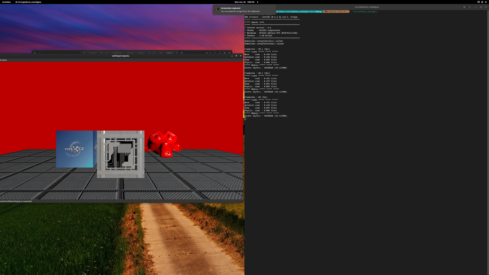

## vortxGE v0.6.4

# NOTE: Only tested on manjaro Linux (Linux only for now).

vortxGE is a graphics library written in C++ around OpenGL and Bullet physics. It aims to keep platform code seperate from the engine.
License : LGPL

## Features
* Spline animation for objects and Materials. You can also add your own animation properties.
* Bullet Physics Engine integration
* Code targets openGL 4.3 and above. Comes with some default GLSL shaders.
* Threaded Move and Optimize pipeline on scene nodes.
* Frustum culling.
* Occlusion culling via passes and bounding mesh.
* Object emitter with physics

## Simple examples showing how to use vortxGE with other libraries.
* vortxGEdemo_gtkmm - gtkmm v4 example
* vortxGEdemo_glfw3 - GLFW v3 example
* vortxGEdemo_sdl2 - SDL v2 example

# Tools
* [obj2vbm](tools/obj2vbm) OBJ to VBM (Native Mesh) converter
