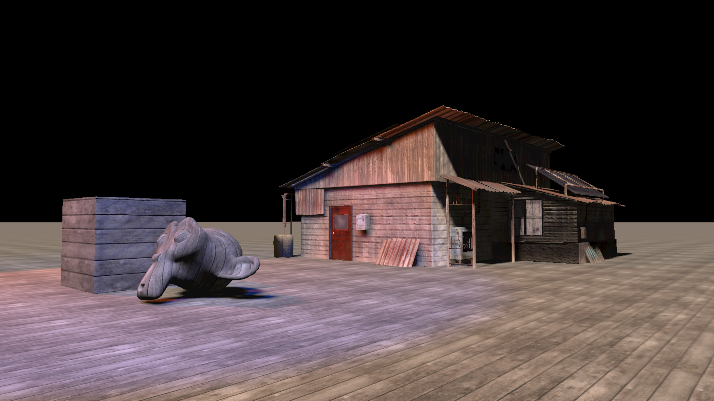

# vortxGE

vortxGE is a lightweight, modern 3D graphics engine written in C++20. It is designed for creating real-time graphics applications and simulations on Linux, featuring a flexible rendering pipeline, physics integration, and a straightforward asset workflow with Blender.

## Features

*   **Modern C++20 Codebase:** Utilizes modern C++ features for robust and maintainable code.
*   **OpenGL 4.3+ Rendering Pipeline:**
    *   Pass-based rendering system (e.g., direct-to-screen, render-to-texture with FBOs).
    *   Physically Based Rendering (PBR) using a Cook-Torrance BRDF model, supporting albedo, normal, and metallic/roughness/AO maps.
    *   Dynamic shadow mapping for spot lights.
*   **Hierarchical Scene Graph:**
    *   A node-based system (`lsNode`) for managing scenes, objects, lights, and cameras.
    *   Supports Point and Spot light types.
*   **Physics Integration:**
    *   Built-in integration with the Bullet Physics library.
    *   Supports rigid body dynamics with various collision shapes (Box, Capsule, Plane, Convex Hull, Triangle Mesh).
    *   Includes a physics-based first-person character controller with walking, sprinting, crouching, and jumping.
*   **Asset Pipeline:**
    *   Loads modern `glTF` / `.glb` 3D models.
    *   Includes a custom Blender addon (`blender_scripts/export_scene.py`) to export entire scenes. The addon creates a simple `.vgs` (vortxGE Scene) file for scene layout and exports all meshes to individual `.glb` files.
*   **Animation System:**
    *   Keyframe-based animation for node properties (position, rotation, scale) and material properties using cubic curve interpolation.
*   **Demos:**
    *   Includes demos for both **GTKmm 4.0** and **GLFW3**, showcasing how to integrate the engine into different windowing and UI toolkits.

## Building vortxGE

The project uses CMake for building.

### Dependencies

*   **Core:**
    *   CMake (version 3.29 or newer)
    *   A C++20 compatible compiler (e.g., GCC, Clang)
    *   Bullet Physics
    *   GLEW
    *   OpenGL libraries (GLVND preference)

*   **Demos (Optional):**
    *   For `vortxGEdemo_glfw3`: **glfw3**
    *   For `vortxGEdemo_gtkmm`: **gtkmm-4.0**

### Build Instructions

1.  Clone the repository.
2.  Create a build directory and navigate into it:
    ```bash
    mkdir build
    cd build
    ```
3.  Run CMake to configure the project:
    ```bash
    cmake ..
    ```
4.  Compile the project:
    ```bash
    make
    ```

This will build the `vortxGE` library and all associated demos and tools.

## Asset Pipeline with Blender

The primary workflow for creating scenes is through Blender.

1.  **Install the Addon:** Install the `blender_scripts/export_scene.py` script as an addon in Blender.
2.  **Create Your Scene:** Build your scene in Blender with meshes, lights (Point and Spot), and cameras.
3.  **Export:** Use `File > Export > vortxGE Scene (.vgs)`. This will:
    *   Create a `.vgs` file describing the scene's hierarchy, including the positions, rotations, and scales of all objects and lights.
    *   Export each mesh as a separate `.glb` file into a `meshes` subdirectory.
    *   The engine's `lsSceneManager` can then load this `.vgs` file to reconstruct the scene.

## Demos

The project includes two demos to showcase its functionality.

### vortxGEdemo_glfw3

A standalone application using GLFW3 for windowing and input. It features the first-person character controller, allowing you to walk around and explore a test scene with PBR materials and dynamic shadows.

*   **Controls:**
    *   **W, A, S, D:** Move
    *   **Mouse:** Look around
    *   **Space:** Jump
    *   **Left Shift:** Sprint
    *   **Left Control:** Crouch
    *   **F1:** Toggle fullscreen
    *   **Escape:** Exit

### vortxGEdemo_gtkmm

This demo shows how `vortxGE` can be integrated as a widget within a larger GTKmm 4.0 application.

### Running the Demos

After building, the executables can be found in the `build/` directory:

```bash
cd build/
# Run the GLFW3 demo
./demos/vortxGEdemo_glfw3/vortxGEdemo_glfw3

# Run the GTKmm demo
./demos/vortxGEdemo_gtkmm/vortxGEdemo_gtkmm
```

